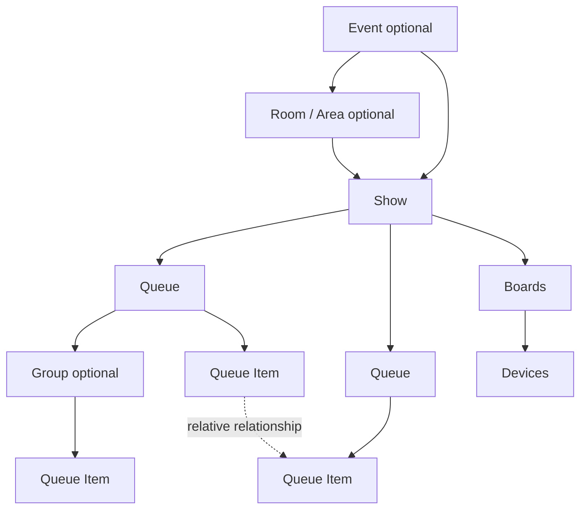

# Domain model

## Core object graph



The Event and Room layers are optional. `Show` is the primary standalone product object.

## Event

Optional container for a larger production. Owns/organizes Shows, Rooms/Areas and event-level overview. It is not required for a Quick Timer.

## Room / Area

Optional physical/virtual location. A Show is assigned to at most one Room at a time. If similar Show content is needed in another Room, duplicate it rather than making one live Show belong to multiple Rooms.

A Room can host multiple Shows over time.

## Show

Standalone operational unit. Contains one or more peer Queues, defaults, timing settings and runtime Show State.

Recommended fields/concepts:

- identity/name;
- optional Event/Room;
- timezone;
- primary/program Queue;
- timing mode/defaults;
- warning defaults;
- lifecycle/ownership;
- lock state;
- version/revision.

## Queue

Ordered lane of Queue Items. Queues are peers. Typical presets include Program, Stage Management, Audio, Lighting, Video and Broadcast, but `purpose` must be extensible.

Recommended Queue runtime projection:

- current item;
- next eligible item;
- ahead/behind relative to schedule when applicable.

## Group

Real container within a Queue. A Group owns ordered child Queue Items and can be collapsed, moved or duplicated with its children.

Avoid arbitrary recursive nesting in V1. One Group level is enough unless a product decision explicitly extends it.

## Queue Item

Universal unit. There are no separate core entities for Speaker, Break, Note, Timer or Cue. UI presets preconfigure the same base object.

Optional properties include:

- title/subtitle/description;
- notes;
- tags;
- speaker/presenter metadata;
- scheduled start/end;
- duration;
- timer configuration;
- start/end behavior;
- fixed anchor;
- active/inactive/skip status;
- visibility/audience rules;
- relationships;
- future Actions.

## Queue Item relationship

Links an item to an anchor item in another peer Queue with a relative offset.

Example:

```text
Program: Keynote             10:00
Audio:   Headset live        -01:00 relative to Keynote
Light:   Keynote look         00:00 relative to Keynote
```

Relationship is synchronization metadata, not ownership. The linked item remains a member of its own Queue.

## Timer

Timer is a capability/configuration of a Queue Item, not a top-level scheduling entity.

Runtime state is documented in `TIMER_ENGINE.md`.

## Board

Presentation definition over data/state. Contains source/filter configuration and layout/components. A Board may be attached to zero or more Audiences and displayed on zero or more Devices.

## Audience

Logical destination grouping, e.g. Stage, Production, Backstage, Public, Broadcast. Used for visibility and ad-hoc messages.

## Device

Persistent known client/display endpoint with an ID, name, status and Board assignment. Device identity is not equivalent to authorization.

## User / Role / Permission

Users receive capabilities through permission bundles/roles in a relevant scope. Avoid role-name checks in domain behavior.

## Message

Ad-hoc operational message such as `AFRONDEN`. It is separate from Queue content. It has destinations/audiences and optional auto-expiry.

## Lock

Protects mutable structures from accidental changes. Can target Event, Room, Show, Queue, Group or Item. Permission-gated emergency override is audited.

## Action

Future extensibility object that invokes an external integration in response to an event such as start/end/warning. Not required as a full engine in V1.

## Recommended `current` model

Because parallel Queues are independent, each Queue should have its own `currentItemId`.

A Show has a `primaryQueueId` (normally Program). Global `current` and `next` shown in general Boards are projections from that primary Queue unless the Board selects another Queue.

This prevents Audio/Stage queues from fighting the Program queue for a single global current pointer.
