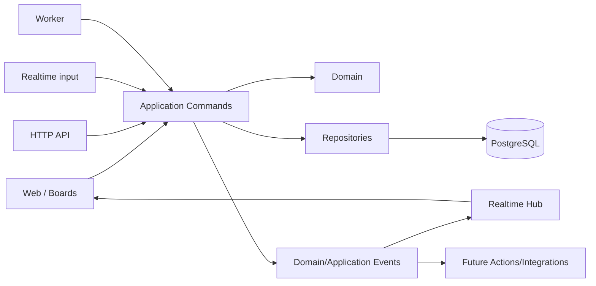

# Technical architecture baseline

**Status: Accepted baseline for implementation.**

Product semantics in `FUNCTIONAL_DESIGN.md` remain the source of truth. Changing a named library later is allowed only when the boundaries and behavior below remain intact or a new ADR explicitly supersedes them.

## Repository layout

```text
apps/
  web/                 Next.js/React UI, Operator/Master and Boards
  server/              Fastify HTTP API + realtime + authoritative Show State
  worker/              lifecycle/email/cleanup/housekeeping
packages/
  domain/              pure domain entities, value objects and rules
  application/         commands/use-cases; mandatory shared mutation boundary
  contracts/           validated DTOs, commands, snapshots and realtime events
  db/                  Drizzle schema/migrations/repositories
  ui/                  shared UI primitives/components
  config/              shared TypeScript/lint/build configuration
```

Do not put domain rules directly into Next.js components, Fastify routes or Drizzle models.

## Accepted tooling baseline

- TypeScript strict mode;
- pnpm workspaces;
- Turborepo;
- Next.js + React for the web application;
- Fastify for HTTP/realtime application service;
- PostgreSQL for durable persistence;
- Drizzle ORM/migrations;
- Socket.IO-class websocket transport for reconnect/rooms/events;
- Zod-class runtime validation for shared contracts;
- Vitest for unit/integration testing;
- Playwright for browser/E2E testing;
- Pino-style structured logging;
- Docker Compose for local infrastructure and ACC/PRD runtime projects.

Choose stable maintained package versions at bootstrap time; document selected versions in the repository.

## One public product domain

The canonical production / public domain is **`klockr.live`** (decision 2026-11-09). Web, API and realtime remain accessible under that one origin through reverse-proxy routing:

```text
https://klockr.live/                 web
https://klockr.live/api/v1/...       server API
https://klockr.live/realtime/...     realtime transport
```

Rules:

- `klockr.live` is the PRD public URL; ACC uses its own hostname (not yet decided, `OPEN_QUESTIONS.md` #24) with the **same images**.
- Runtime code never hardcodes a domain. Internal routes stay relative (`/api/v1`, `/realtime`, `/show/<id>`, `/show/<id>/edit`, `/b/<token>`); links shown in the UI (e.g. the Speaker Board link) are built from the current origin.
- Where an absolute URL must be produced without a request origin (e.g. future magic-link e-mails from the worker), it comes from the environment variable `KLOCKR_PUBLIC_URL` (`https://klockr.live` in PRD, the ACC URL in ACC, `http://localhost:3000` locally).
- Credential cookies are host-only (no `Domain` attribute), so an ACC cookie can never be sent to PRD or vice versa.

The reverse proxy may be managed outside the application Compose project on the dedicated server.

## Layering



The same named application use cases are used by internal UI and external API. Future OSC/Companion adapters must also call this layer rather than reimplementing behavior.

## State categories

Keep these concepts explicit:

1. **Domain state** — what Queue Items, timers, locks, relationships and permissions mean.
2. **Application/live state** — what is currently happening in a Show.
3. **Persisted state** — durable configuration and important live transitions/timestamps.
4. **Client projection** — what a Board renders from authoritative state.

A Speaker Board never owns a separate authoritative timer.

## Timer architecture

Timers are timestamp-derived mathematical projections.

- Do not persist or broadcast one tick per second.
- Persist/broadcast transitions such as start, pause, resume, adjust, stop and end.
- Snapshots/events include authoritative server timestamp and monotonically ordered revision/sequence data.
- Clients render ticking values locally.
- Reconnect obtains/verifies a fresh authoritative snapshot and corrects drift calmly.

## Realtime state

V1 runs one authoritative application/realtime server instance per environment. Redis/pub-sub is intentionally excluded from V1 until measured scale/availability requirements justify it.

The design must make later distribution possible without changing domain command semantics.

## Background work

`apps/worker` handles non-live responsibilities such as expiry cleanup, email and housekeeping. It shares domain/application code but never becomes the authoritative timer engine.

## Persistence

PostgreSQL stores durable product configuration plus important state transitions/actual timestamps. Use transactions for multi-entity operations where partial application would be unsafe.

ACC and PRD each run their own PostgreSQL container in their own Compose project with a persistent named volume and independent backups.

## Concurrency and idempotency

Use revision/version checks and idempotency where appropriate.

Examples:

- stale Master drag/drop conflicts instead of overwriting newer order;
- duplicate external START with same idempotency key cannot start twice;
- reconnect snapshot supersedes stale realtime events.

## Identity/auth boundaries

See `IDENTITY_AUTH_LIFECYCLE.md` and ADR-0007.

Primary product behavior:

- anonymous New Show receives secret management grant in creating browser;
- claiming/account login uses email magic link;
- social login can be added later;
- account/member access uses scoped permissions;
- temporary role links may grant time-limited Operator-style access without an account;
- Board links are narrow read-only share grants by default;
- paired Devices receive persistent revocable credentials;
- API integrations use separate scoped tokens;
- Platform Admin support impersonation is explicit and audited.

Keep the auth provider behind an adapter. Provider choice must not leak into the domain model.

## Assets

If V1 supports uploaded logos/backgrounds, use an asset-storage abstraction. Do not store large binary assets in PostgreSQL by default. Exact object storage remains a deferred implementation decision until asset upload enters scope.

## Environment/runtime model

See `DEPLOYMENT_RUNTIME.md` and ADR-0008.

- DEV/TST: Claude/local + CI; app processes may run natively, local Postgres via Compose.
- ACC: independent Docker Compose project on dedicated server.
- PRD: independent Docker Compose project on dedicated server.
- ACC/PRD each contain web, server, worker and PostgreSQL services.
- PRD deployment is explicit/manual.
- Build once; promote the exact same images from ACC to PRD.

## Operational requirements

- HTTPS;
- long-lived websocket connections;
- stable system clock/NTP;
- backups and tested restore procedure;
- structured logs/metrics;
- safe database migrations;
- graceful process shutdown/reconnect behavior;
- production deploys must not silently interrupt active shows.

## Selected versions (M0, 2026-11-09)

| Concern         | Package                               | Version                                             |
| --------------- | ------------------------------------- | --------------------------------------------------- |
| Runtime         | Node.js                               | 24 LTS (>= 24.11)                                   |
| Package manager | pnpm                                  | 12.16.1                                             |
| Monorepo        | turbo                                 | 2.11.10                                             |
| Language        | typescript                            | 6.0.3 (TS 7 not yet supported by typescript-eslint) |
| Web             | next / react / react-dom              | 16.4.5 / 19.3.1 / 19.3.1                            |
| Server          | fastify                               | 5.12.8 (built-in Pino logger)                       |
| Worker logging  | pino                                  | 10.4.0                                              |
| Contracts       | zod                                   | 4.6.7                                               |
| Persistence     | drizzle-orm / drizzle-kit / pg        | 0.45.4 / 0.31.11 / 8.23.1                           |
| Database        | PostgreSQL image                      | postgres:18-alpine                                  |
| Tests           | vitest / @playwright/test             | 5.1.0 / 1.65.0 (Playwright config scaffold only)    |
| Lint/format     | eslint / typescript-eslint / prettier | 10.14.0 / 8.72.1 / 3.9.10                           |
| App bundling    | tsup / tsx (dev)                      | 9.0.0 / 4.23.15                                     |

| Realtime (M1) | socket.io / socket.io-client | 4.8.4 / 4.8.4 |
| HTTP plugins (M1) | @fastify/cookie / @fastify/rate-limit / cookie | 11.1.5 / 11.2.2 / 2.0.2 |
| Fonts (M1) | @fontsource-variable/inter / @fontsource/roboto-mono | 5.3.0 / 5.3.0 (self-hosted, work offline) |

Realtime transport rationale and behavior: `REALTIME_OFFLINE.md` (Implementation M1).

See `docs/DEVELOPMENT.md` for commands, build model and migration workflow.
