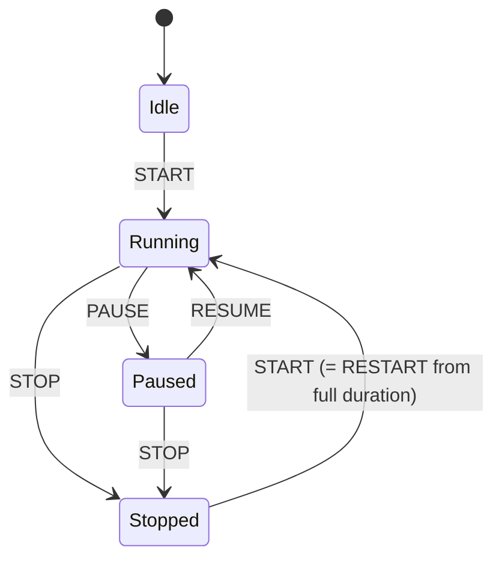

# Timer engine

## Goals

The timer engine must be deterministic, testable without a UI and independent of realtime/integration transports.

## Conceptual states



Timer states are exactly `idle`, `running`, `paused` and `stopped` (decision 2026-11-09, M0 review). There is no timer `Ended` state: END / NEXT ends a **Queue Item**, not a timer (see "STOP versus END" below).

`Overtime` is a derived display/timing condition while a countdown is Running and the derived remaining value has crossed zero. It is not a separate persistent state.

## Core values

Persist transitions/timestamps, not ticking values.

A timer runtime needs enough data to derive its current value, e.g.:

- mode: countdown / count-up;
- state;
- nominal duration;
- accumulated adjustments;
- startedAt;
- pausedAt;
- accumulated paused duration;
- endedAt/stoppedAt where relevant;
- version.

Exact persistence representation is an implementation detail, but the domain API must remain timestamp-based.

## Countdown

Typical display:

```text
20:00 -> ... -> 00:01 -> 00:00 -> +00:01 -> +00:02
```

When the configured end behavior allows overtime, the same timer continues beyond zero.

## Warning states

Configurable states inherit using:

`Show -> Queue -> Queue Item`

Typical effective states:

- normal;
- warning;
- critical;
- overtime.

Thresholds can be expressed as absolute remaining duration or percentage where supported.

The UI must show when an item uses an override instead of inherited values.

## Controls

Minimum operations:

- START;
- PAUSE;
- RESUME;
- STOP (timer);
- END / END+NEXT (Queue Item / show-control level, not a timer command);
- adjust positive/negative time;
- direct item/timer selection.

`STOP` is never an alias for `END`.

### STOP versus END (decision 2026-11-09)

STOP:

- affects only the timer;
- triggers no next-item behaviour;
- triggers no end actions.

END / NEXT:

- operationally ends the Queue Item;
- may exist for an item without a timer;
- may be executed when the item's timer is already stopped;
- may later run end actions, change current/next and optionally start the next item.

END is therefore a Queue Item / show-control command (`EndItem`), introduced together with the Queue Item lifecycle. It is not a transition of the timer state machine.

### START after STOP (decision 2026-11-09)

START on a stopped timer starts again from the full configured duration: functionally a RESTART. Adjustments from the previous run do not carry over. In stopped state the UI must present this action as RESTART.

## Adjustment behavior

Before zero, adding time increases the displayed remaining time.

The current product decision for overtime is that adjustment operates on the displayed overtime value as selected during requirements. Example: a `+30` operation at `+02:14` produces `+02:44`.

This is intentionally called out because it is non-obvious and should be validated again during UI prototyping. Do not silently reinterpret it as “grant 30 seconds back” without a product decision.

Adjustment may cross the zero boundary in both directions (decision 2026-11-09). Contract examples:

| Before | Adjustment | After |
| --- | --- | --- |
| `02:00` remaining | `+00:30` | `02:30` remaining |
| `+00:10` overtime | `-00:30` | `00:20` remaining |
| `+02:14` overtime | `+00:30` | `+02:44` overtime |

Overtime remains derived state and is never persisted separately.

## Start modes

Per item:

- `manual` — operator explicitly starts;
- `scheduled` — item has a schedule trigger policy;
- `previous_end` — starts after the configured previous/preceding item END;
- `external` — API/integration command invokes the normal application start command.

### Scheduled variants

Default scheduled behavior is soft: if the item is due while a blocking/current item is still live, show the late/due status rather than blindly starting.

Hard scheduled start may be configurable per item/queue later or where explicitly enabled.

## End behavior

Timer end behavior must be explicit and composable. Examples:

- continue into overtime;
- stop at zero;
- mark/end item;
- end and start next item.

Start behavior and end behavior are separate settings.

## Multiple running timers

The engine must support multiple simultaneous timers. Only the relevant Queue current pointer changes on GO/NEXT; unrelated running timers remain running unless an explicit rule stops them.

## Clock/test requirements

- Domain services receive a Clock abstraction.
- Unit tests use a fake/manual clock.
- Avoid sleeping in tests.
- Test pause/resume, repeated commands, overtime, large adjustments, reconnect snapshot derivation and clock skew handling.

## Implementation (M0)

Implemented in `packages/domain/src/timer/timer.ts` as pure functions over an immutable `TimerState`:
`createTimer`, `configureTimer`, `startTimer`, `pauseTimer`, `resumeTimer`, `stopTimer`, `adjustTimer`, `deriveTimer`.

Stored fields: `mode`, `status` (`idle | running | paused | stopped`), `durationMs`, `adjustmentMs`, `startedAt`, `pausedAt`, `pausedTotalMs`, `stoppedAt`, `revision`. All instants are UTC epoch milliseconds supplied by an injected `Clock` (`systemClock` in production, `ManualClock` in tests).

Implementation rules (the first two confirmed in the M0 review, see decisions above):

- START from `stopped` is a RESTART: fresh run from the full configured duration; earlier adjustments are cleared. A pre-start adjustment made while `idle` is kept.
- Adjustment math is continuous across zero in both directions.
- Adjustments are allowed in `idle`, `running` and `paused`; not in `stopped`.
- Count-up adjustments never take elapsed time below zero.
- `configure` is only allowed in `idle` or `stopped` and resets the timer to `idle`.
- Durations are integer milliseconds, capped at 7 days.

Display rounding is a presentation concern, implemented in `packages/ui` (`formatTimer`): countdown remaining is floored and overtime ceiled, so each displayed second lasts one second and the documented sequence `00:01 -> 00:00 -> +00:01` holds.

Timer phase (`normal | warning | critical | overtime`) is derived by `timerPhase()` in the domain; thresholds are provisional (see `OPEN_QUESTIONS.md` #5). An idle timer is always `normal`.
