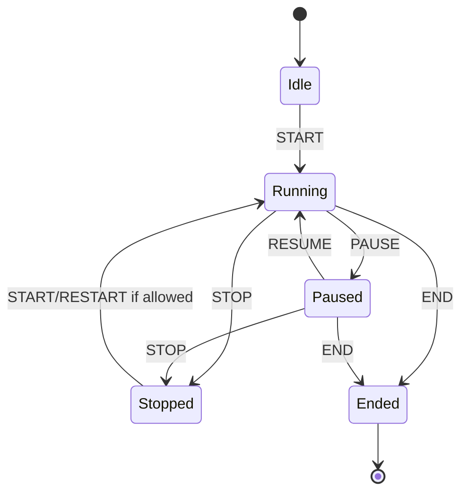

# Timer engine

## Goals

The timer engine must be deterministic, testable without a UI and independent of realtime/integration transports.

## Conceptual states



`Overtime` is a derived display/timing condition while a countdown is Running and the derived remaining value has crossed zero. It is not a separate persistent state.

## Core values

Persist transitions/timestamps, not ticking values.

A timer runtime needs enough data to derive its current value, e.g.:

- mode: countdown / count-up;
- state;
- nominal duration;
- accumulated adjustments;
- startedAt;
- pausedAt;
- accumulated paused duration;
- endedAt/stoppedAt where relevant;
- version.

Exact persistence representation is an implementation detail, but the domain API must remain timestamp-based.

## Countdown

Typical display:

```text
20:00 -> ... -> 00:01 -> 00:00 -> +00:01 -> +00:02
```

When the configured end behavior allows overtime, the same timer continues beyond zero.

## Warning states

Configurable states inherit using:

`Show -> Queue -> Queue Item`

Typical effective states:

- normal;
- warning;
- critical;
- overtime.

Thresholds can be expressed as absolute remaining duration or percentage where supported.

The UI must show when an item uses an override instead of inherited values.

## Controls

Minimum operations:

- START;
- PAUSE;
- RESUME;
- STOP;
- END;
- NEXT/END+NEXT at queue/application level;
- adjust positive/negative time;
- direct item/timer selection.

`STOP` is never an alias for `END`.

## Adjustment behavior

Before zero, adding time increases the displayed remaining time.

The current product decision for overtime is that adjustment operates on the displayed overtime value as selected during requirements. Example: a `+30` operation at `+02:14` produces `+02:44`.

This is intentionally called out because it is non-obvious and should be validated again during UI prototyping. Do not silently reinterpret it as “grant 30 seconds back” without a product decision.

## Start modes

Per item:

- `manual` — operator explicitly starts;
- `scheduled` — item has a schedule trigger policy;
- `previous_end` — starts after the configured previous/preceding item END;
- `external` — API/integration command invokes the normal application start command.

### Scheduled variants

Default scheduled behavior is soft: if the item is due while a blocking/current item is still live, show the late/due status rather than blindly starting.

Hard scheduled start may be configurable per item/queue later or where explicitly enabled.

## End behavior

Timer end behavior must be explicit and composable. Examples:

- continue into overtime;
- stop at zero;
- mark/end item;
- end and start next item.

Start behavior and end behavior are separate settings.

## Multiple running timers

The engine must support multiple simultaneous timers. Only the relevant Queue current pointer changes on GO/NEXT; unrelated running timers remain running unless an explicit rule stops them.

## Clock/test requirements

- Domain services receive a Clock abstraction.
- Unit tests use a fake/manual clock.
- Avoid sleeping in tests.
- Test pause/resume, repeated commands, overtime, large adjustments, reconnect snapshot derivation and clock skew handling.

## Implementation (M0)

Implemented in `packages/domain/src/timer/timer.ts` as pure functions over an immutable `TimerState`:
`createTimer`, `configureTimer`, `startTimer`, `pauseTimer`, `resumeTimer`, `stopTimer`, `endTimer`, `adjustTimer`, `deriveTimer`.

Stored fields: `mode`, `status` (`idle | running | paused | stopped | ended`), `durationMs`, `adjustmentMs`, `startedAt`, `pausedAt`, `pausedTotalMs`, `stoppedAt`, `endedAt`, `revision`. All instants are UTC epoch milliseconds supplied by an injected `Clock` (`systemClock` in production, `ManualClock` in tests).

Interpretations made in M0 where the docs were not explicit (recorded in `OPEN_QUESTIONS.md` for validation):

- START from `stopped` is a RESTART: fresh run from the full configured duration; earlier adjustments are cleared. A pre-start adjustment made while `idle` is kept.
- Overtime adjustment math is continuous: `-30` at `+00:10` gives `00:20` remaining.
- Adjustments are allowed in `idle`, `running` and `paused`; not in `stopped` or `ended`.
- Count-up adjustments never take elapsed time below zero.
- `configure` is only allowed in `idle` or `stopped` and resets the timer to `idle`.
- END is allowed from `running` and `paused` (per the state diagram), not from `idle` or `stopped`.
- Durations are integer milliseconds, capped at 7 days.

Display rounding (e.g. how 59.4 s is shown) is a presentation concern and is not decided in the domain.
